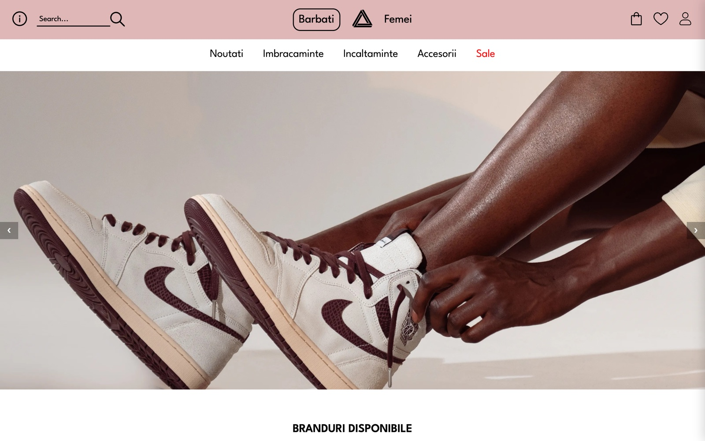
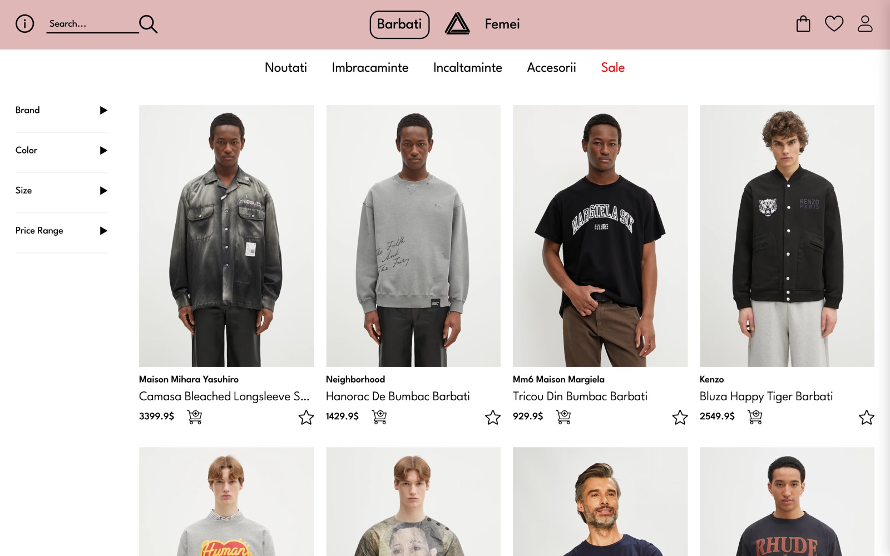

# Shopping Website (frontend)

This is a clothing store website I built from scratch while learning web
development. I wanted to make something that felt like a real shop, so it has
a product grid, filters, accounts, a wishlist and a cart.

You can see it live here: https://shopping-website-frontend.netlify.app

The backend is on Render's free plan, so if nobody has opened the site in a
while, the products can take about a minute to show up. After that it works
normally.

This repo is the React part. The API and database are in
[shopping-website-backend](https://github.com/PantofaruTudor/shopping-website-backend).

I first wrote the site in plain HTML, CSS and JavaScript, then rebuilt it in
React once it got too big to manage. The login state, wishlist and cart are
kept in React Context, and the cart is saved in localStorage so it doesn't
disappear when you refresh the page.

To run it locally, start the backend first, then:

    cd client
    npm install
    npm start

The `.env` file in `client/` points the app to the local backend at
http://localhost:5001.
